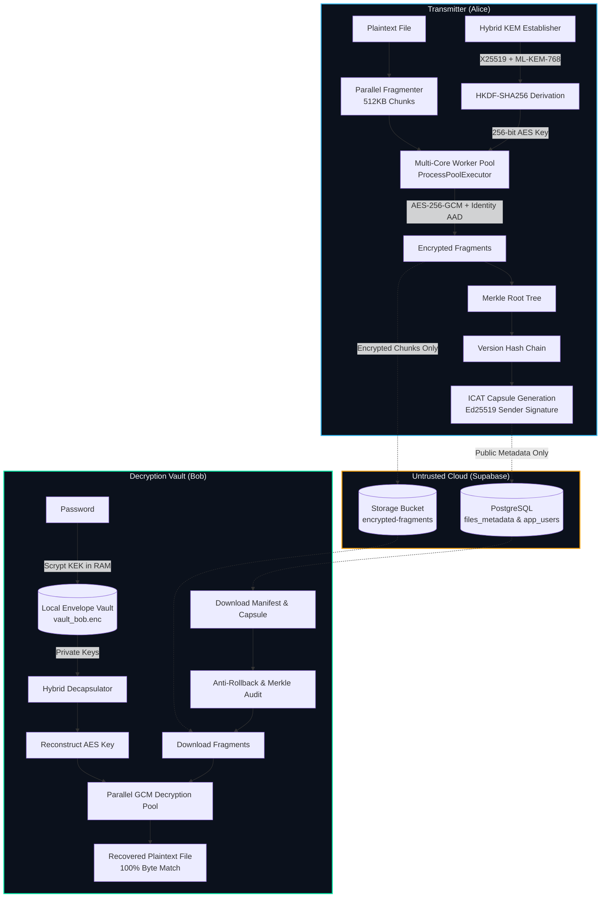
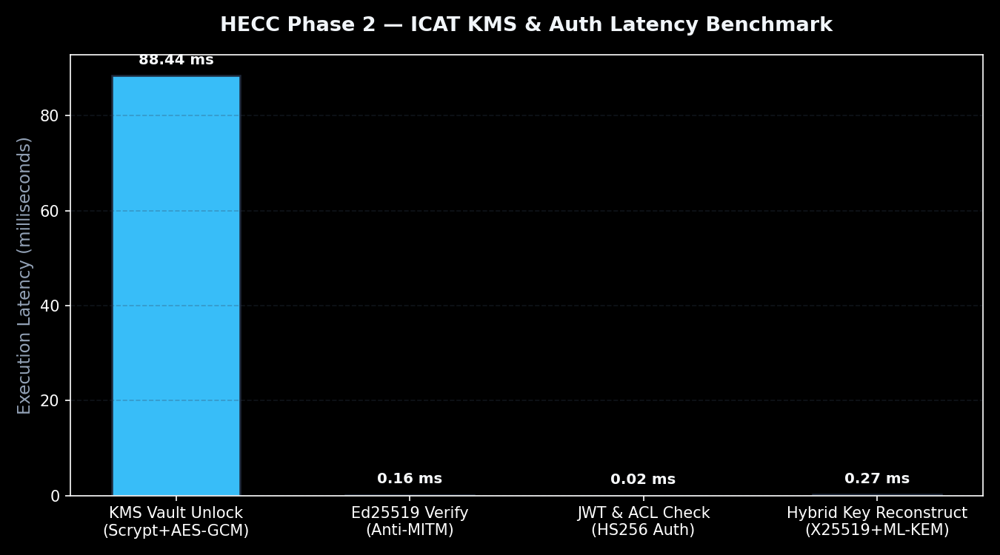

<div align="center">

# 🛡️ HECC Phase 2: Quantum-Resistant Hybrid Cloud Security
### Identity-Bound Cryptographic Access Capsule (ICAC) & Dual-Primitive Post-Quantum Key Management

[](https://www.python.org/)
[-00e5a3.svg?style=flat&logo=target)](https://csrc.nist.gov/pubs/fips/203/final)
[](https://datatracker.ietf.org/doc/html/rfc7748)
[](https://csrc.nist.gov/publications/detail/sp/800-38d/final)
[](https://fastapi.tiangolo.com/)
[-3ecf8e.svg?logo=supabase&logoColor=white)](https://supabase.com/)
[-brightgreen.svg?logo=pytest&logoColor=white)](test_icat_security_suite.py)
[](LICENSE)

<br/>

> **Final Year Project**: An end-to-end zero-knowledge secure transmission and storage platform designed to defeat both the **Untrusted Cloud threat** and the **Harvest Now, Decrypt Later (HNDL)** quantum computing vulnerability.

</div>

---

## 📌 Executive Summary

Modern cloud storage providers (AWS, Google Drive, Azure) operate on full-trust models where cloud administrators, database leaks, or government subpoenas expose plaintext files. Furthermore, adversaries are actively archiving encrypted internet traffic to decrypt once large-scale quantum computers break classical RSA and Elliptic Curve Cryptography.

**HECC Phase 2** resolves both problems through a **dual-layer post-quantum hybrid architecture**:
1. **Dual-Primitive Key Agreement**: Simultaneously binds classical Diffie-Hellman (`X25519`) and NIST-standardized lattice cryptography (`ML-KEM-768`) via `HKDF-SHA256`. An adversary must compromise *both* mathematical foundations to access the session key.
2. **Identity-Bound Cryptographic Access Capsules (ICAT)**: Every encrypted chunk's Additional Authenticated Data (AAD) is mathematically bound to `file_id : version : chunk_idx : sender : receiver`, rendering chunk swapping and injection attacks impossible.
3. **Zero-Trust Client-Side KMS Vaults**: Private keys are generated and wrapped on the client device using `Scrypt` Key Encryption Keys (KEK). **No private keys or plaintexts ever touch the cloud.**
4. **Anti-Rollback & Merkle Integrity Ledger**: All fragments form a cryptographic Merkle tree root chained across versions, preventing silent cloud file modification or version rollback attacks.

---

## 🏗️ System Architecture



---

## ⚡ Core Cryptographic Pillars

| Pillar | Primitive / Standard | Security Objective |
| :--- | :--- | :--- |
| **Post-Quantum KEM** | NIST FIPS 203 (`ML-KEM-768`) | Neutralizes quantum Shor's algorithm attacks (*Harvest Now, Decrypt Later*). |
| **Classical Key Exchange** | RFC 7748 (`X25519`) | Provides 128-bit classical security with 15+ years of production verification. |
| **Digital Signatures** | RFC 8032 (`Ed25519`) | Eliminates Man-In-The-Middle (MITM) database key tampering & signs ICAT capsules. |
| **Payload Encryption** | NIST SP 800-38D (`AES-256-GCM`) | High-speed authenticated encryption with parallel chunk processing. |
| **Identity Binding (AAD)** | Custom ICAT Identity Spec | Incorporates `sender_email` + `receiver_email` into every chunk's GCM tag. |
| **Client Key Management** | RFC 7914 (`Scrypt KDF`) | Two-tier envelope vault (`KEK` $\rightarrow$ `DEK` $\rightarrow$ Private Keys) strictly in client RAM. |
| **Integrity & Anti-Rollback** | Merkle Tree + SHA-256 Hash Chain | Proves total file integrity and prevents cloud providers from serving stale versions. |

---

## 📊 Security Benchmark & Performance Telemetry

The platform includes an automated security test harness ([test_icat_security_suite.py](test_icat_security_suite.py)) benchmarking key generation, encapsulation, encryption throughput, and attack resistance.

<div align="center">
  
</div>

### Security Benchmark Results (100% Pass Rate):
- ✅ **Vault Derivation & Attestation**: Memory-hard Scrypt KDF successfully deters offline brute-force attacks.
- ✅ **Unauthenticated Access Defense**: Route-level JWT ACL rejects requests without valid tokens (`401 Unauthorized`).
- ✅ **Unauthorized User ACL**: Unauthorized third parties (e.g., Eve) are rejected on downloads and deletes (`403 Forbidden`).
- ✅ **Identity Capsule Tampering Guard**: Altering recipient emails in `.icat.json` triggers `CapsuleSignatureError` and AES-GCM `InvalidTag`.
- ✅ **Anti-MITM Public Key Guard**: Modifying cloud-side public keys triggers `UntrustedPublicKeyError` via Ed25519 validation.
- ✅ **End-to-End Recovery**: 100% bit-exact reassembly verified across fragmented payloads.

---

## 🆚 Comparison with Existing Solutions

| Feature | Standard Cloud (Drive / S3) | Traditional PGP / GPG | HECC Phase 2 (This Project) |
| :--- | :---: | :---: | :---: |
| **Quantum Resistance** | ❌ None | ❌ None (RSA / ECC only) | ✅ **Dual-Hybrid (ML-KEM-768 + X25519)** |
| **Private Key Custody** | ⚠️ Managed by Cloud | ⚠️ Manual keyrings / files | ✅ **Client-Side RAM-Only Scrypt Vault** |
| **Identity-Bound Chunking** | ❌ None | ❌ None | ✅ **AES-256-GCM Identity AAD** |
| **Anti-Rollback Verification** | ⚠️ Cloud-managed | ❌ None | ✅ **Merkle Tree + Local Version Ledger** |
| **Multi-Core Throughput** | Single-threaded | Single-threaded | ✅ **Parallel Multiprocessing Engine** |
| **User Experience** | Single Password | Complex Cert Management | ✅ **Single Email + Password Workflow** |

---

## 🚀 Quick Start Guide

### 1. Prerequisites
- **Python 3.10 - 3.13** installed.
- Git installed.

### 2. Installation
```powershell
# Clone the repository
git clone https://github.com/suhasbp37/hecc_phase2.git
cd hecc_phase2

# Install dependencies
pip install -r requirements.txt
```

### 3. Environment Setup
Copy `.env.example` to `.env` and provide your Supabase credentials:
```powershell
copy .env.example .env
```
Execute [sql_setup.sql](sql_setup.sql) and [sql_icat_patch.sql](sql_icat_patch.sql) inside your Supabase SQL Editor.

### 4. Run the Server
```powershell
python -m uvicorn app:app --reload --port 8000
```

### 5. Access Dashboards
- **Transmitter (Sender)**: [`http://localhost:8000/`](http://localhost:8000/)
- **Decryption Vault (Receiver)**: [`http://localhost:8000/receiver`](http://localhost:8000/receiver)
- **Interactive API Documentation**: [`http://localhost:8000/docs`](http://localhost:8000/docs)

---

## 🧪 Running the Test Suite

Execute the full cryptographic security suite:
```powershell
python -m pytest test_icat_security_suite.py -v
```

---

## 📁 Repository Structure

```text
hecc_phase2/
├── app.py                         # FastAPI backend service & routes
├── requirements.txt               # Dependencies (FastAPI, cryptography, oqs, supabase)
├── .env.example                   # Environment configuration template
├── sql_setup.sql                  # Database schema for files_metadata
├── sql_icat_patch.sql             # Database schema for app_users & public_keys
├── test_icat_security_suite.py    # 8-stage automated security test suite
├── icat_kms_benchmark.png         # Performance benchmark telemetry chart
├── HOW_TO_RUN.md                  # Comprehensive step-by-step setup guide
├── PROJECT_EXPLANATION.md         # Conceptual plain-English viva explainer
├── core/
│   ├── auth_acl.py                # PBKDF2 hashing, JWT tokens, and ACL checks
│   ├── icat_kms.py                # Split-trust envelope vault & ICAT capsules
│   ├── hybrid_crypto.py           # X25519 + ML-KEM-768 hybrid key establishment
│   ├── parallel_engine.py         # Multi-process AES-256-GCM chunking & Merkle roots
│   └── cloud_storage.py           # Supabase chunk upload/download with retry
└── web/
    ├── index.html                 # Transmitter web interface (Sender)
    └── receiver.html              # Decryption Vault interface (Receiver)
```

---

## 📜 License

This project is licensed under the **MIT License** — see the [LICENSE](LICENSE) file for details.

---

<div align="center">
Developed as a Final Year Project in Cyber Security & Cryptography.<br/>
Made with ❤️ by <strong>Suhas B P</strong>
</div>
